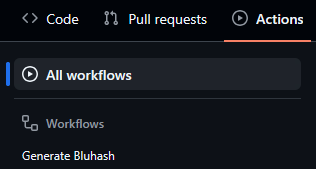
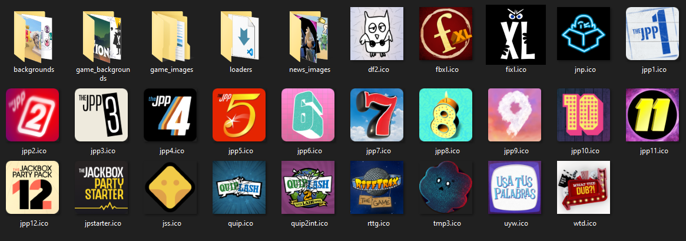
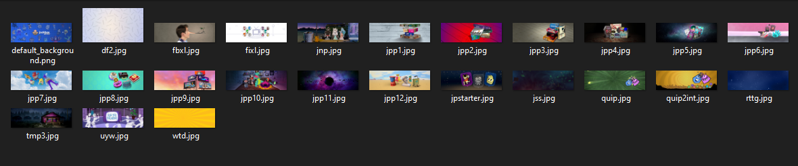
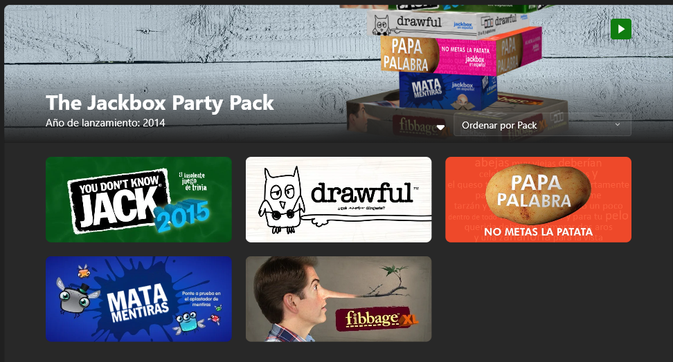
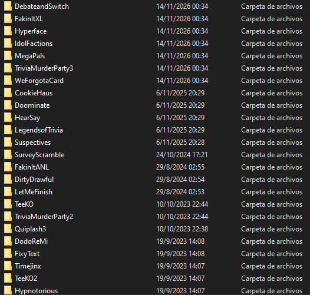
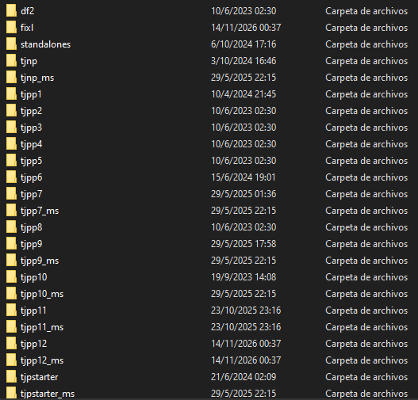

# Jackbox Utility Server - Jackbox en español

Este repositorio contiene la información del servidor de Jackbox en español para Jackbox Utility, que ofrece la fácil instalación de todos sus parches.
Se listan los archivos relevantes para su mantenimiento, y sus contenidos.

## info.json 

Este archivo contiene la información general del servidor. En principio, ninguno de estos contenidos cambia seguido.

- `id`: Identificador del servidor, debe ser único ("jackbox-es")
- `name`: El nombre del servidor ("Jackbox en español")
- `description`: La descripción del servidor ("¡El servidor de la comunidad de Jackbox en español!")
- `image`: La imagen que se muestra como ícono del servidor. Se utiliza una encontrada en la carpeta `assets/news_images`.
- `urls`: Enlaza a la api y assets que hay en este repositorio.
- `controller`: El controlador utilizado por el servidor, que se muestra en la aplicación (jackbox.lol)
- `languages`: El lenguaje que utiliza la aplicación al utilizar el servidor ("es" = español)
- `links`: Incluye los enlaces que se muestran debajo del servidor en ajustes. Cada enlace presenta los siguientes atributos:
  - `icon`: ícono que se muestra a la izquierda. Los íconos vienen de [este](https://bdlukaa.github.io/fluent_ui/) sitio.
  - `url`: Enlace al que lleva al clickear. Las imágenes utilizadas se colocan en la carpeta `assets/news_images`.
  - `text`: Texto que se muestra al lado del ícono.

## api

La carpeta api contiene la información de la API utilizada para comunicar los contenidos del servidor a la aplicación.

### api/blurHashes.json

Se usa para mostrar el blurhash (efecto blurreado) de las imágenes antes que carguen. Este archivo se actualiza cuando se agregan imágenes al servidor; se hace a través de Actions. Para actualizarlo, ejecutas la acción y pusheas el archivo generado.

### api/configurations.json

para ciertas configuraciones específicas por servidor
Lo usamos para habilitar los efectos de sonido por defecto (no lo está por defecto) y para mostrar un link de donación cuando se terminan de instalar los parches.

### api/messages.json

Se utiliza para mostrar mensajes en la pantalla principal. Se podría usar para poner tipo countdowns a una release de algo, por ejemplo, o para que cierto texto aparezca solo en cierta fecha. 

De momento, se utiliza para dar instrucciones específicas para los parches de Microsoft Store.

### api/packs.json

Contiene los datos de los parches ofrecidos.

### api/welcome.json

Se utiliza para el carrusel de banners en el inicio de la aplicación. En nuestro caso, dejamos tres banners, dos de ellos fijos: Un enlace a Discord, una bienvenida a la Utility, y una que muestra la única novedad del momento. Esta última es la única que se cambia seguido.
- `news`: Contiene todos los paneles presentados en el carrusel del servidor.
  - `id`: Fecha y hora de la novedad. Utilizadas para definir si se debe mostrar a un usuario dicha novedad o no. Podría usarse para dejar preparadas novedades con anticipación.
  - `title`: Ttítulo que aparece en dichos banners
  - `smallDescription`: textito grande que aparece abajo del título
  - `content`: lo que está abajo de eso
  - `image`: imagencita que se usa

## assets

Contiene los elementos utilizados por el servidor, separados en carpetas. Los íconos de cada juego se encuentran sueltos en esta carpeta.

### assets/backgrounds

En backgrounds están los fondos que se usan en la sección "Buscar por Pack" cuando seleccionás dicho Pack.

Ejemplo:

### assets/game_backgrounds

Esta carpeta contiene los banners de cada juego.

### assets/game_images

Esta carpeta contiene las imágenes que aparecen tipo carrusel cuando te muestra la info de un juego.

### assets/Loaders

Contiene lo que se usa ahora mismo para Epic, Microsoft Store y copias manualmente añadidas para que se saltee la intro al ejecutar los juegos directamente.
Cada loader es un zip que incluye ciertos archivos que se reemplazan en el juego una vez que se ejecuta. `default.zip` es el archivo sin modificar, y cada uno de los otros es lo que se modifica para que se pueda saltear la intro. Estos parches suelen tener la siguiente forma:
  1. Modifican el swf que contiene la palabra Loader.
  2. En los juegos por separado viejos, colocan un usm vacío

En los loaders de los packs, varía caso por caso lo que se cambia, pero en general los pasos son los siguientes:
- En `jackboxgames.loader.LoaderGame`:
  1. Cambiar `PICKER_NAME` por el nombre de la carpeta del juego
  2. Cambiar `PICKER_SWF` por el nombre del swf en la carpeta del juego
  3. En la función `_startListeningForPressStart()`, hay que agregar `onExitToPicker();` antes de `this._listenToInput = true`
  4. En el comienzo de la función, en la subfunción `_loadPauseMenu`, borrar las dos líneas que tiene y agregar estas:

    `_currentView.disableSkip();`
  
    `restart();`

En `jackboxgames.loader.ui.startView`:
  - En la función `_doAppearSequence`, cambiar `_startBehaviors.setShown(true,c.generateDoneFn());` a `_startBehaviors.setShown(false,c.generateDoneFn());`

#### Casos especiales de Loaders:

- **The Jackbox Party Pack 1**
  - En Mata Mentiras y en Drawful está también el SWF principal modificado con la línea de los guardados para evitar un softlock en alguno de los 2 juegos (el que se abra segundo).
  - Los demás juegos del Pack, exceptuando Papa Palabra, también se modifican para mantener los guardados de los enunciados que se juegan.
- **Quiplash (Mac):** Como en esta plataforma hacer que tome el DLC es complicado su loader incluye tanto el directorio sin modificar como el directorio de Mac a la vez.
- **The Jackbox Party Pack 7:** El loader tiene que ser con el archivo de MS para que el texto de copyright de abajo no esté todo bugueado.
- **Microsoft Store:** Los loaders del en Microsoft Store tienen que ser diferentes. Particularmente, no se tiene que saltear lo que aprieta el Enter automáticamente porque sino los ajustes que pusiste en los juegos (activar subtítulos, cambiar a otro idioma, etc) no van a estar y lo vas a tener que ajustar todo cada vez. Esto hace que se omita el paso 3 de las instrucciones de arriba para `jackboxgames.loader.LoaderGame`; y se omite por completo el cambio en `jackboxgames.loader.ui.startView`.
