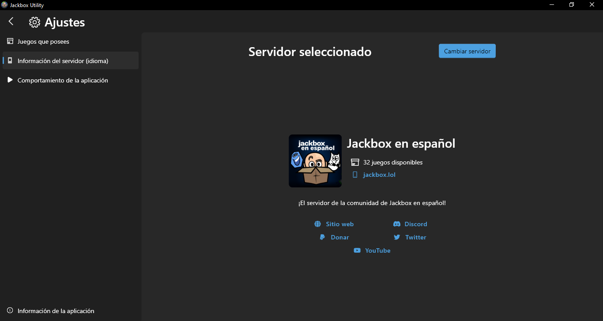
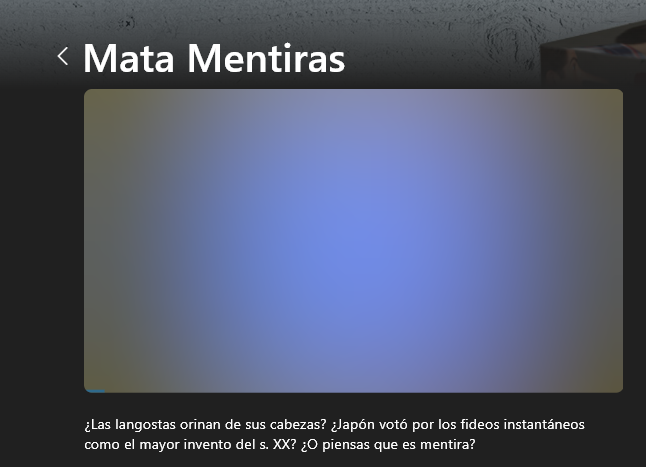
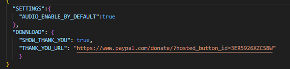

# Jackbox Utility Server - Jackbox en español

Este repositorio contiene la información del servidor de Jackbox en español para Jackbox Utility, que ofrece la fácil instalación de todos sus parches.
Se listan los archivos relevantes para su mantenimiento, y sus contenidos.

## info.json 

Este archivo contiene la información general del servidor. En principio, ninguno de estos contenidos cambia seguido.

- `id`: Identificador del servidor, debe ser único ("jackbox-es")
- `name`: El nombre del servidor ("Jackbox en español")
- `description`: La descripción del servidor ("¡El servidor de la comunidad de Jackbox en español!")
- `image`: La imagen que se muestra como ícono del servidor ([esta](https://raw.githubusercontent.com/AkiraArtuhaxis/JackboxUtility-Server-es/main/assets/news_images/logo.png))
- `urls`: Enlaza a la api y assets que hay en este repositorio.
- `controller`: El controlador utilizado por el servidor, que se muestra en la aplicación (jackbox.lol)
- `languages`: El lenguaje que utiliza la aplicación al utilizar el servidor ("es" = español)
- `links`: Incluye los enlaces que se muestran debajo del servidor en ajustes. Cada enlace presenta los siguientes atributos:
  - `icon`: ícono que se muestra a la izquierda. Los íconos vienen de [este](https://bdlukaa.github.io/fluent_ui/) sitio.
  - `url`: Enlace al que lleva al clickear.
  - `text`: Texto que se muestra al lado del ícono.
 
## api/blurHashes.json

Se usa para mostrar el blurhash (efecto blurreado) de las imágenes antes que carguen. Este archivo se actualiza cuando se agregan imágenes al servidor; se hace a través de Actions. Para actualizarlo, ejecutas la acción y pusheas el archivo generado.

## api/configurations.json

para ciertas configuraciones específicas por servidor
Lo usamos para habilitar los efectos de sonido por defecto (no lo está por defecto) y para mostrar un link de donación cuando se terminan de instalar los parches.

## api/messages.json

Se utiliza para mostrar mensajes en la pantalla principal. Se podría usar para poner tipo countdowns a una release de algo, por ejemplo, o para que cierto texto aparezca solo en cierta fecha. 

De momento, se utiliza para dar instrucciones específicas para los parches de Microsoft Store.

## api/packs.json

Contiene los datos de los parches ofrecidos.

## api/welcome.json

Se utiliza para el carrusel de banners en el inicio de la aplicación. En nuestro caso, dejamos tres banners, dos de ellos fijos: Un enlace a Discord, una bienvenida a la Utility, y una que muestra la única novedad del momento. Esta última es la única que se cambia seguido.
- `news`: Contiene todos los paneles presentados en el carrusel del servidor.
  - `id`: Fecha y hora de la novedad. Utilizadas para definir si se debe mostrar a un usuario dicha novedad o no. Podría usarse para dejar preparadas novedades con anticipación.
  - `title`: Ttítulo que aparece en dichos banners
  - `smallDescription`: textito grande que aparece abajo del título
  - `content`: lo que está abajo de eso
  - `image`: imagencita que se usa
