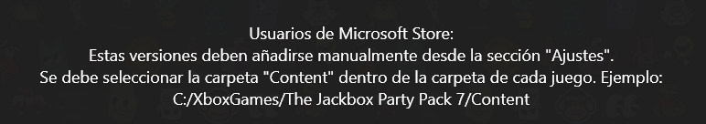
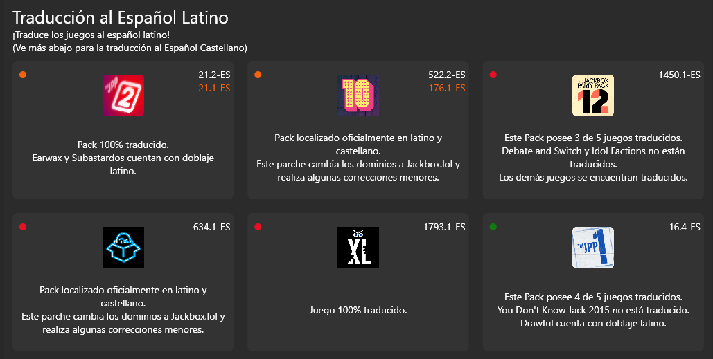
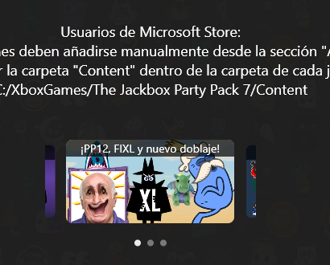
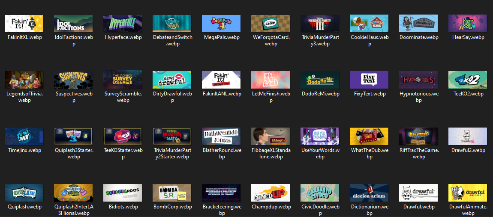

# Jackbox Utility Server - Jackbox en español

Este repositorio contiene la información del servidor de Jackbox en español para Jackbox Utility, que ofrece la fácil instalación de todos sus parches.
Se listan los archivos relevantes para su mantenimiento, y sus contenidos.

## Resumen rápido:

### Actualizar un parche de un juego ya agregado a la Utility

TBD

### Añadir un juego nuevo a la Utility

1. Agregar el nuevo pack en `packs.json`, completando con información encontrada [aquí](https://github.com/AkiraArtuhaxis/JackboxUtility-Server-es/tree/main#packs).
2. Poner el `id` de los parches agregados en el paso 1 en `patchsCategories` -> `patchs` -> `spanish_patchs` (para Latinoamérica) y/o `spanish_spain_patchs` (para España).

## info.json 

Este archivo contiene la información general del servidor. En principio, ninguno de estos contenidos cambia seguido.

- `id`: Identificador del servidor, debe ser único ("jackbox-es")
- `name`: El nombre del servidor ("Jackbox en español")
- `description`: La descripción del servidor ("¡El servidor de la comunidad de Jackbox en español!")
- `image`: La imagen que se muestra como ícono del servidor. Se utiliza una encontrada en la carpeta `assets/news_images`.
- `urls`: Enlaza a la api y assets que hay en este repositorio.
- `controller`: El controlador utilizado por el servidor, que se muestra en la aplicación (jackbox.lol)
- `languages`: El lenguaje que utiliza la aplicación al utilizar el servidor ("es" = español)
- `links`: Incluye los enlaces que se muestran debajo del servidor en ajustes. Cada enlace presenta los siguientes atributos:
  - `icon`: ícono que se muestra a la izquierda. Los íconos vienen de [este](https://bdlukaa.github.io/fluent_ui/) sitio.
  - `url`: Enlace al que lleva al clickear. Las imágenes utilizadas se colocan en la carpeta `assets/news_images`.
  - `text`: Texto que se muestra al lado del ícono.

## api

La carpeta api contiene la información de la API utilizada para comunicar los contenidos del servidor a la aplicación.

### api/blurHashes.json

Se usa para mostrar el blurhash (efecto blurreado) de las imágenes antes que carguen. Este archivo se actualiza cuando se agregan imágenes al servidor; se hace a través de Actions. Para actualizarlo, ejecutas la acción y pusheas el archivo generado.

### api/configurations.json

para ciertas configuraciones específicas por servidor
Lo usamos para habilitar los efectos de sonido por defecto (no lo está por defecto) y para mostrar un link de donación cuando se terminan de instalar los parches.

### api/messages.json

Se utiliza para mostrar mensajes en la pantalla principal. Se podría usar para poner tipo countdowns a una release de algo, por ejemplo, o para que cierto texto aparezca solo en cierta fecha. 

De momento, se utiliza para dar instrucciones específicas para los parches de Microsoft Store.

### api/packs.json

Contiene los datos de los parches ofrecidos.

#### tags

Los `tags` son la manera en que pueden categorizar tus juegos en la Utility.
- `id` (no pueden ser iguales entre sí)
- `name`: nombre que se muestra
- `icon`: Los íconos vienen de [este](https://bdlukaa.github.io/fluent_ui/) sitio.
- `description`: descripción que aparece al buscar por etiqueta.

#### patchCategories

`patchCategories` es la sección de "Todos los parches" de "Instalar parches". Normalmente hay una sola, pero tenemos dos para ofrecer una para jugadores de España (que no instalar el doblaje latino de Drawful 2 ni la adaptación latina de Quiplash 2, y sí instala la traducción castellana de WTD y su doblaje del Quiplash original).

  - `id`: no tienen que ser iguales
  - `name`: el nombre que se muestra
  - `smallDescription`: la descripción que está abajo del nombre dado
  - `patchs`: los parches que están incluidos en esa categoría

#### packs

Cada entrada de `packs` representa a un Pack que va a estar en la Utility.

  - `id`: No se puede repetir
  - `name`: nombre
  - `description`: La descripción que aparece en "Buscar por Pack".
  - `launchers_id`: Los ids que se usan para que los juegos puedan ser detectados automáticamente por la Utility cada vez que se inicia o con el botón de "Ajustes".
  - `executables`: El nombre del ejecutable del juego para cada plataforma.
  - `loader`: donde va el loader por default que se restaura cuando se cierra la Utility
  - `configuration`: lo que se usa para ver qué archivito se va a usar para detectar la versión del parche que tenés
  - `version_origin` Contiene el nombre del archivo que muestra la versión de juego
  - `version_file`: Se usaba antes, ahora no.
  - `version_property`: La línea que tiene que leer la Utility del archivo para chequear la versión.
  - `launcher_version_file`: El tipo de archivo que tiene que detectar, por plataforma.
  - `steam` y `epic_games` se explican solos. `native` se utiliza para los juegos agregados manualmente.
    - Post-Megapicker, todas las versiones de Steam hasta ese momento se actualizaron, cambiando el nombre de "config.jet" a "jbg.config.jet"; pero en Epic todo sigue como antes.
  - `resource_location`: Contiene el directorio que tiene que leer la aplicación para instalar los parches en Mac
    - Caso especial de Quiplash 1: Se deja en blanco
  - `store_links`: Enlaces de tienda que aparecen cuando no tenés el juego agregado a la app. Se aceptan tiendas `steam`, `epic`, `jackbox_games_store`. Usamos el último para las versiones de Microsoft Store.
  - `patchs`: Contiene los parches del Pack. Hay diferentes tipos de parches del mismo juego para otras plataformas o tiendas, según las necesidades de cada una. Estos se ocultan si la plataforma no es soportada o el tipo de tienda es diferente.
    - `id`: no pueden ser iguales.
    - `name`: el nombre del parche.
    - `small_description`: la descripción que aparece en "Todos los parches" y en la sección de parches de cada Pack en particular.
    - `description`: No se usa
    - `patch_path`: el link del parche.
    - `version_origin`: De dónde saca el número de versión del parche (`repo_file` = del repositorio linkeado).
    - `version_file` De qué link lee el número de versión.
    - `version_property`: de qué variable del archivo saca el número de versión (ej: `buildVersion`).
    - `supported_platforms`: Las plataformas que soporta el parche
    - `supported_launchers`: El tipo de tienda que soporta
    - `components`: Está cada juego del Pack incluido en el parche. Se explica en detalle en la siguiente subsección.
    - `games`: La información de cada juego que se usa en el launcher. Se explica en detalle en la siguiente subsección.
    - `icon`: ícono de juego.
    - `background`: fondo de juego.
   
##### packs -> components

- `components`: Está cada juego del Pack incluido en el parche.
  - `id`: no pueden ser iguales.
  - `linked_game`: es de dónde busca los assets que se muestran. Osea, el banner y qué juego se muestra cuando apretás dicho banner en la sección de parches de ese juego.
  - `name`: El nombre del juego/parche del juego.
  - `description`: La descripción del juego, que aparece debajo del título al apretar el botón de info.
  - `authors`: los créditos que se muestran al apretar el botón de info.
  - `small_description`: la descripción que aparece en la sección de parches de ese Pack.
  - `patch_type`: Detalla qué cambios se realizan en el parche (`game_text`, `game_assets`, `game_subtitles`, `website`, `audios`)

##### packs -> games

- `games`: La información de cada juego que se usa en el launcher
  - `id`: no pueden ser iguales.
  - `name`: el nombre que se muestra
  - `internal_name` es el nombre que se usa internamente en el juego para poder ejecutarse directamente con comandos (lo que usa Steam) (opcional)
  - `background` el banner que se usa
  - `path` dónde se encuentra el juego, también para ejecutarse con comandos (opcional)
  - `game_info` es el tipo de jugadores y el playtime que tiene ese juego
  - `family-friendly` si es family-friendly o no (valores: `NOT_FAMILTY_FRIENDLY` | `OPTIONAL` | `FAMILY-FRIENDLY`)
  - `Audience`: si tiene público o no
  - `Stream-friendly`: si es apto para streams o no (valores: `NOT_PLAYABLE` | `MIDLY PLAYABLE` | `PLAYABLE`).
  - `stream_friendly_description`: Usada para describir los posibles problemas de jugar en partidas transmitidas (opcional).
  - `moderation`: si tiene moderación o no (valores: `FULL_MODERATION` | `CENSORING` | `NO_MODERATION`)
  - `moderation_description`: es lo mismo a lo otro que dije. Es opcional (aunque yo lo pongo siempre en este caso)
  - `Subtitles` si tiene subtítulos o no.
  - `Type` es el tipo de juego que es (valores: `VERSUS` | `COOP` | `TEAM`)
  - `translation` el tipo de traducción que tiene (valores: "NATIVELY_TRANSLATED", "COMMUNITY_TRANSLATED" o "ENGLISH")
  - `tagline` es lo que aparece junto al banner cuando hacés hover en el launcher
  - `small_description` la pequeña descripción que aparece en la info de cada juego (yo pongo lo mismo que la tagline)
  - `description` la descripción grande del juego
  - `audience_description`, que de vuelta es opcional. Yo lo uso para explicar qué exactamente hace el público en el juego.
  - `images` son las imágenes que pueden aparecer en el carrusel de imágenes Donde como dije puede haber videos que solo se muestran en la versión 1.3.7 pero si no están o si estás en una versión más reciente no aparecen
  - `tags` son las tags que tiene el juego en base a lo primero que expliqué de este archivo
  - `loader` es el loader que usa el juego
    - `path`
    - `version` se usa por si alguna vez hay que actualizar un loader
  - `launch_with_loaders` es si los loaders se usan dependiendo del tipo de versión (Si está en "false" se usa el sistema de comandos por defecto, que es lo que usa Steam. Si está en "true", que es el caso de Epic y las versiones añadidas manualmente, se usan.)
  - `patchs`: variable depreciada.

### api/welcome.json

Se utiliza para el carrusel de banners en el inicio de la aplicación. En nuestro caso, dejamos tres banners, dos de ellos fijos: Un enlace a Discord, una bienvenida a la Utility, y una que muestra la única novedad del momento. Esta última es la única que se cambia seguido.
- `news`: Contiene todos los paneles presentados en el carrusel del servidor.
  - `id`: Fecha y hora de la novedad. Utilizadas para definir si se debe mostrar a un usuario dicha novedad o no. Podría usarse para dejar preparadas novedades con anticipación.
  - `title`: Título que aparece en dichos banners
  - `smallDescription`: textito grande que aparece abajo del título
  - `content`: lo que está abajo de eso
  - `image`: imagencita que se usa

## assets

Contiene los elementos utilizados por el servidor, separados en carpetas. Los íconos de cada juego se encuentran sueltos en esta carpeta.

### assets/backgrounds

En backgrounds están los fondos que se usan en la sección "Buscar por Pack" cuando seleccionás dicho Pack.

Ejemplo:

### assets/game_backgrounds

Esta carpeta contiene los banners de cada juego.

### assets/game_images

Esta carpeta contiene las imágenes y videos que aparecen tipo carrusel cuando te muestra la info de un juego. 
Los videos solo son compatibles en la versión 1.3.7 de Utility por ahora, por lo que están ocultos por defecto. A la hora de subir videos, se recomienda utilizar el comando `ffmpeg -i nombredelvideo.mp4 nombredelvideodiferente.mp4` para comprimirlos.

### assets/Loaders

Contiene lo que se usa ahora mismo para Epic, Microsoft Store y copias manualmente añadidas para que se saltee la intro al ejecutar los juegos directamente.
Cada loader es un zip que incluye ciertos archivos que se reemplazan en el juego una vez que se ejecuta. `default.zip` es el archivo sin modificar, y cada uno de los otros es lo que se modifica para que se pueda saltear la intro. Estos parches suelen tener la siguiente forma:
  1. Modifican el swf que contiene la palabra Loader.
  2. En los juegos por separado viejos, colocan un usm vacío

En los loaders de los packs, varía caso por caso lo que se cambia, pero en general los pasos son los siguientes:
- En JPEXS, usando "Edit Actionscript" en `jackboxgames.loader.LoaderGame`:
  1. Cambiar `PICKER_NAME` por el nombre de la carpeta del juego
  2. Cambiar `PICKER_SWF` por el nombre del swf en la carpeta del juego
  3. En la función `_startListeningForPressStart()`, hay que agregar `onExitToPicker();` antes de `this._listenToInput = true`
     - El paso 3 se omite en loaders de Microsoft Store.
  5. En el comienzo de la función, en la subfunción `_loadPauseMenu`, borrar las dos líneas que tiene y agregar estas:

    `_currentView.disableSkip();`
  
    `restart();`

En JPEXS, usando "Edit Actionscript" en `jackboxgames.loader.ui.startView`:
  - En la función `_doAppearSequence`, cambiar `_startBehaviors.setShown(true,c.generateDoneFn());` a `_startBehaviors.setShown(false,c.generateDoneFn());`
    - Los cambios en `jackboxgames.loader.ui.startView` se omiten en loaders de Microsoft Store.

#### Casos especiales de Loaders:

- **The Jackbox Party Pack 1**
  - En Mata Mentiras y en Drawful está también el SWF principal modificado con la línea de los guardados para evitar un softlock en alguno de los 2 juegos (el que se abra segundo).
  - Los demás juegos del Pack, exceptuando Papa Palabra, también se modifican para mantener los guardados de los enunciados que se juegan.
- **Quiplash (Mac):** Como en esta plataforma hacer que tome el DLC es complicado su loader incluye tanto el directorio sin modificar como el directorio de Mac a la vez.
- **The Jackbox Party Pack 7:** El loader tiene que ser con el archivo de MS para que el texto de copyright de abajo no esté todo bugueado.
- **Microsoft Store:** Los loaders del en Microsoft Store tienen que ser diferentes. Particularmente, no se tiene que saltear lo que aprieta el Enter automáticamente porque sino los ajustes que pusiste en los juegos (activar subtítulos, cambiar a otro idioma, etc) no van a estar y lo vas a tener que ajustar todo cada vez. Esto hace que se omita el paso 3 de las instrucciones de arriba para `jackboxgames.loader.LoaderGame`; y se omite por completo el cambio en `jackboxgames.loader.ui.startView`.
